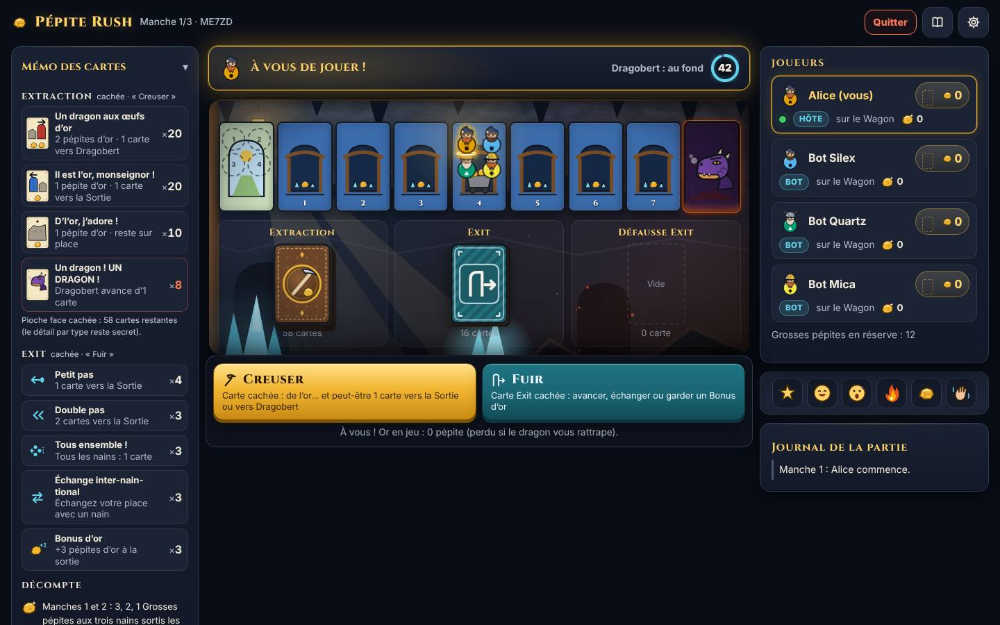

# Pépite Rush

Version en ligne, jouable à plusieurs en temps réel (2 à 6 joueurs), d'un jeu de cartes « stop ou encore » : chaque joueur guide un nain dans une mine, ramasse de l'or et doit sortir avant que le dragon ne le rattrape. Trois manches, le plus riche gagne.

> **Droits.** Les règles implémentées sont celles du jeu **My Gold Mine** (© Franckh-Kosmos / IELLO), décrites dans [`docs/REGLES.md`](docs/REGLES.md). « Pépite Rush » est un **nom de travail**. À la demande du commanditaire, les noms des cartes et du dragon (Dragobert) sont ceux du livret ([`i18n/fr.ts`](packages/client/src/i18n/fr.ts), [`branding.ts`](packages/shared/src/branding.ts)) ; toutes les illustrations sont des dessins SVG originaux et aucun logo ni visuel de l'éditeur n'est présent dans ce dépôt (voir [`docs/CREDITS.md`](docs/CREDITS.md)). **Toute publication utilisant ces noms ou le jeu original nécessite l'accord préalable de l'éditeur.**



## Prérequis

- **Node.js 20.19 ou plus récent** (testé avec Node 22) et **npm 10**.
- Aucune base de données, aucun Docker, aucune clé d'API.

## Installation et lancement en local

```bash
npm install
npm run dev
```

`npm run dev` lance ensemble :

- le serveur de jeu (port **3000**, rechargé à chaque modification) ;
- le client Vite (port **5173**), qui relaie `/ws` vers le serveur.

Ouvrez <http://localhost:5173>, créez un salon et partagez le code (ou le lien `?salon=CODE`). Les salons publics apparaissent aussi dans la liste « Salons ouverts » de l'accueil ; l'hôte peut rendre le sien privé. Pour tester seul : ajoutez des bots dans le salon, ou ouvrez plusieurs fenêtres de navigation privée.

## Scripts

| Commande              | Rôle                                                                                                        |
| --------------------- | ----------------------------------------------------------------------------------------------------------- |
| `npm run dev`         | Serveur + client en mode développement                                                                      |
| `npm run check`       | Lint (ESLint + Prettier), vérification des types, tests : **à lancer avant chaque push**                    |
| `npm test`            | Tous les tests (Vitest)                                                                                     |
| `npm run coverage`    | Tests avec couverture du moteur (seuil : 90 % des lignes)                                                   |
| `npm run simulate`    | Simulation de parties entre bots (options : `--games`, `--policy random\|heuristic`, `--dragons`, `--seed`) |
| `npm run build`       | Construit le client (`packages/client/dist`) et le serveur (`packages/server/dist`)                         |
| `npm start`           | Lance le serveur construit, qui sert aussi le client                                                        |
| `npm run format`      | Formate le code avec Prettier                                                                               |
| `npm run smoke`       | Parties complètes à 2, 4 et 6 joueurs dans Chromium, sans erreur console (après `npm run build`)            |
| `npm run screenshots` | Captures des écrans clés dans `docs/screenshots/` (3 tailles d'écran, avec et sans mouvement réduit)        |
| `npm run perf`        | Poids du build, temps de chargement et images par seconde (ordinateur et téléphone simulé)                  |

## Jouer en réseau local depuis votre PC

Tous les joueurs doivent être sur le même réseau (même Wi-Fi ou même box).

1. Sur le PC qui héberge la partie :

   ```bash
   npm install
   npm run build
   npm start
   ```

   Le serveur affiche ses adresses, par exemple :

   ```
   Pépite Rush : serveur prêt.
     Sur ce PC           : http://localhost:3000
     Sur le réseau local : http://192.168.1.42:3000
   ```

2. **Pare-feu.** Sous Windows, à la première exécution, acceptez la fenêtre « Autoriser l'accès » pour Node.js en cochant **Réseaux privés**, et vérifiez que votre Wi-Fi est réglé en réseau **privé** (Paramètres → Réseau et Internet → propriétés du Wi-Fi) : en réseau « public », Windows bloque les autres appareils. Sous macOS, acceptez les connexions entrantes pour `node`. Sous Linux avec ufw : `sudo ufw allow 3000/tcp`.
3. Ouvrez le jeu, créez un salon et envoyez aux autres le **lien d'invitation** du salon (bouton « Copier »). Même si vous ouvrez le jeu via `localhost`, ce lien utilise l'adresse réseau de votre PC. Les autres peuvent aussi taper l'adresse « réseau local » dans leur navigateur et saisir le code du salon.

Si personne n'arrive à se connecter : vérifiez que l'adresse commence bien par `192.168.`, `10.` ou `172.`, que tout le monde est sur le même Wi-Fi (pas sur un réseau « invités » isolé, ni en 4G), et que le pare-feu laisse passer le port 3000. Pour changer de port : `PORT=8080 npm start` (sous Windows PowerShell : `$env:PORT=8080; npm start`).

Pour jouer avec des amis **hors de chez vous**, il faut un hébergeur Node.js (voir ci-dessous) ou un tunnel ; ouvrir un port sur votre box est déconseillé.

## Déploiement (Node.js, sans Docker)

Sur n'importe quelle machine ou hébergeur Node.js (VPS, Render, Railway, Fly.io, etc.) :

```bash
npm ci
npm run build
PORT=3000 npm start
```

Le serveur sert le client construit et la WebSocket (`/ws`) sur le même port. Un point de contrôle `GET /healthz` répond `{"ok":true}`.

Variables d'environnement (toutes facultatives) :

| Variable          | Défaut                 | Rôle                                                                                                |
| ----------------- | ---------------------- | --------------------------------------------------------------------------------------------------- |
| `PORT`            | `3000`                 | Port HTTP                                                                                           |
| `HOST`            | `0.0.0.0`              | Interface d'écoute                                                                                  |
| `GRACE_MS`        | `30000`                | Délai de grâce avant de pouvoir remplacer ou passer un joueur déconnecté                            |
| `BOT_DELAY_MS`    | `1800`                 | Pause minimale avant chaque coup d'un bot ; il attend aussi la fin des animations du coup précédent |
| `PACE_ANIMATIONS` | activé                 | `PACE_ANIMATIONS=0` : les bots et le chrono n'attendent plus les animations (tests)                 |
| `TURN_TIME_MS`    | `45000`                | Temps pour jouer un tour ; passé ce délai, pile ou face entre Creuser et Fuir (`0` pour désactiver) |
| `STATIC_DIR`      | `packages/client/dist` | Dossier du client construit                                                                         |
| `LOG`             | activé                 | `LOG=0` coupe les journaux HTTP                                                                     |

Pour garder le serveur actif sur un VPS, utilisez le gestionnaire de services de la machine (par exemple une unité `systemd` qui lance `npm start` dans le dossier du projet) et placez un proxy HTTPS (Caddy, Nginx) devant : la WebSocket fonctionne alors en `wss://` sans réglage supplémentaire.

**Important :** l'état des parties est en mémoire. Un redémarrage du serveur termine les parties en cours, et il faut **une seule instance** du serveur (pas de répartition de charge) tant qu'une persistance n'est pas branchée sur l'interface `RoomStore`.

## Structure du dépôt

```
packages/
  engine/   Moteur de règles pur et déterministe (aucune dépendance réseau ni DOM)
            src/config/decks.ts     composition des paquets (PROVISOIRE)
            src/rules/houseRules.ts cas non précisés par le livret, un par fonction
            scripts/simulate.ts     simulation de parties entre bots
  shared/   Schémas zod des messages, types du protocole, noms de travail
  server/   Fastify + ws : salons, sessions, reconnexion, bots, vues filtrées
  client/   React + Vite, rendu SVG/CSS/canvas, aucune règle du jeu
            src/director/  réalisateur : événements → séquences animées
            src/fx/        effets (particules, ambiance, chaleur, récapitulatif)
scripts/browser/   Partie de fumée, captures et mesures dans Chromium (Playwright)
docs/
  REGLES.md        Règles (source de vérité)
  DECISIONS.md     Décisions où le livret est muet, composition provisoire, simulations, refonte visuelle
  ARCHITECTURE.md  Flux client → serveur → moteur → vues filtrées, réalisateur
  CREDITS.md       Polices et origine des ressources
  screenshots/     Captures des écrans clés
```

## Animations et réglages

On joue en touchant directement la pioche Extraction (creuser) ou la pioche Exit (fuir). Chaque coup est mis en scène sur la zone des pioches, sans jamais cacher la piste : la carte piochée vole depuis la pioche, marque une pause de suspense puis se retourne ; le dragon déclenche un travelling, un tremblement et un souffle de flammes ; les nains bondissent de carte en carte. Les coups des bots défilent au même rythme que ceux des joueurs. On peut toujours jouer sans attendre la fin d'une animation, et la passer (clic, bouton « Passer », touche Échap).

Le menu **Réglages** (roue dentée) propose : thème (mine ou contraste élevé), animations réduites, vitesse des cinématiques, qualité des effets (basse, moyenne, élevée ou automatique), vibrations et affichage des réactions des autres joueurs. Dans le salon, chacun choisit le chapeau et la barbe de ses nains. Pas de son pour l'instant.

## Ce qui est garanti par les tests

- **Moteur** : chaque carte et action, chaînes de dragons, fins de manche, décompte 3/2/1, égalités, manche 3, variante à 2 joueurs, rejet des actions illégales sans modifier l'état ; propriétés vérifiées par fast-check (conservation des cartes, 12 Grosses pépites au plus, 6 nains au plus, fin de partie garantie, rejouabilité à graine identique, vues sans fuite d'information).
- **Serveur** : parties complètes à 2, 3, 4 et 6 clients WebSocket simulés, variante, joueur seul contre des bots, reconnexion (même vue qu'avant la coupure), délai de grâce, remplacement par un bot, tentatives de triche, absence de données cachées dans le trafic (ordre des pioches, cartes Exit, graine).
- **Animations** : transformation des événements en séquences, file du réalisateur (ordre, passage, débordement, accélération), repères et saut à l'état final ; aucune donnée cachée dans les animations ni dans le récapitulatif, même avec les piles cachées ; les bots attendent la fin des animations.
- **Ordre des cartes** : les pioches sont mélangées une seule fois par manche (et la défausse Exit dès que la pioche se vide) ; un test de propriété vérifie qu'aucune carte n'est jamais tirée au hasard au moment de la pioche.

## Questions ouvertes

1. **Composition réelle des paquets** : la répartition des 58 cartes Extraction et des 16 cartes Exit n'est pas dans le livret. Une composition provisoire est utilisée (voir [`docs/DECISIONS.md`](docs/DECISIONS.md)) ; si vous avez la boîte, comptez les cartes par type et reportez-les dans `packages/engine/src/config/decks.ts`.
2. **Nom définitif** du jeu (et accord de l'éditeur).
3. **Hébergement** : choix de l'hébergeur Node.js et du nom de domaine.
