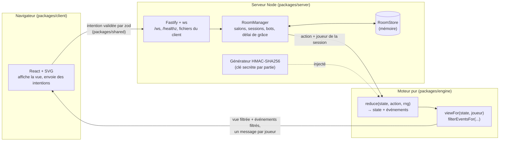
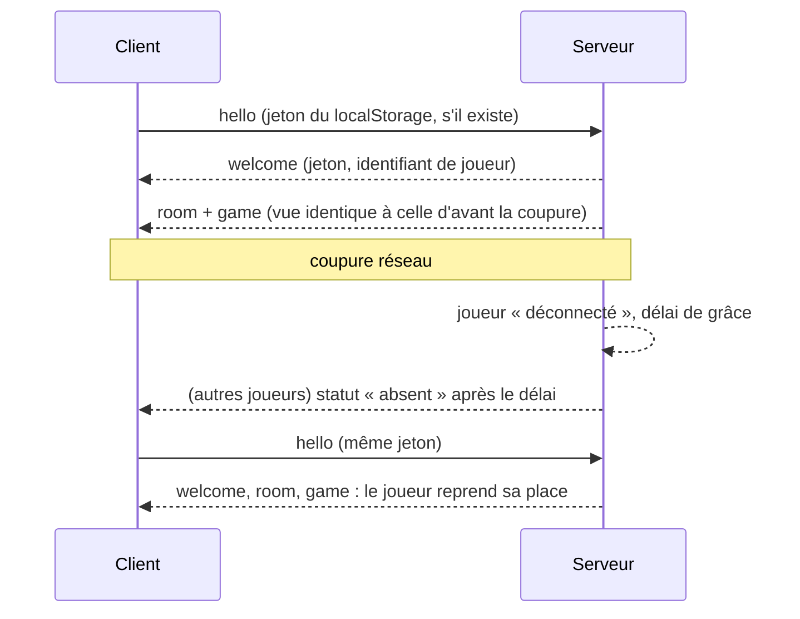

# Architecture

## Vue d'ensemble

1. Le client envoie une **intention** (`{"type":"action","action":{"type":"drawExit"}}`). Il n'indique jamais qui il est : le serveur déduit le joueur de la session WebSocket.
2. Le serveur valide le message avec **zod** (`packages/shared`), applique une limitation de débit, puis appelle `reduce` du moteur avec l'identifiant du joueur.
3. Le moteur vérifie la légalité (bon joueur, bonne phase, choix existant…). Une action illégale renvoie un code d'erreur (`NOT_YOUR_TURN`, `CHOICE_PENDING`…) **sans modifier l'état ni consommer le générateur**.
4. En cas de succès, le serveur garde le nouvel état et envoie à **chaque** joueur `viewFor(état, joueur)` et les événements filtrés pour lui. Le client anime les événements (déplacements, flammes, éliminations) et affiche la vue.

## Paquets

| Paquet   | Rôle                                                                   | Dépendances                                           |
| -------- | ---------------------------------------------------------------------- | ----------------------------------------------------- |
| `engine` | Règles, état, événements, vues filtrées, bots, simulation              | aucune                                                |
| `shared` | Schémas zod des messages entrants, types du protocole, noms de travail | `zod`, types du moteur                                |
| `server` | Transport, salons, sessions, reconnexion, bots, générateur sécurisé    | `fastify`, `@fastify/static`, `ws`                    |
| `client` | Interface React, illustrations SVG, préférences (thème, animations)    | `react` ; types seulement depuis `engine` et `shared` |

Le client n'importe **aucune valeur** du moteur (règle ESLint `no-restricted-imports` avec `allowTypeImports`) : il ne contient pas de logique de règles. Les raisons d'une action impossible (« Ce n'est pas votre tour », « Terminez d'abord votre choix »…) sont calculées par le moteur (`view.legal`) et seulement traduites par le client.

## Moteur

- **État** (`GameState`) : piste de 9 cartes, position du dragon, nains (statut, position, or à l'abri, Grosses pépites), pioches (index 0 = dessus), défausse, boîte, piles d'or en cours, échelle de la Sortie, résultats des manches.
- **Actions** : `drawExtraction`, `drawExit`, `chooseExitAction`, `chooseSwapTarget` (joueur), `startNextRound`, `skipTurn` (système).
- **Événements** : `RoundStarted`, `TurnStarted`, `CardDrawn`, `ExitActionPlayed`, `DwarfMoved`, `DwarfMoveBlocked`, `DwarvesSwapped`, `DragonMoved`, `DwarfEliminated`, `DwarfExited`, `GoldBonusKept`, `ExitCardWasted`, `ExitDeckReshuffled`, `TurnSkipped`, `RoundEnded`, `BigNuggetsAwarded`, `GameEnded`.
- **Déterminisme** : `reduce` ne modifie jamais l'état reçu ; son seul effet de bord est d'avancer le générateur injecté. Même graine + mêmes actions = même état final (testé par propriété).
- **Cas non précisés** : un par fonction dans `src/rules/houseRules.ts`.

## Informations cachées

`viewFor` construit la vue par **liste blanche** :

| Donnée                                         | Envoyée à                                                          |
| ---------------------------------------------- | ------------------------------------------------------------------ |
| Carte du dessus de la pioche Extraction        | tous                                                               |
| Nombre de cartes des pioches                   | tous                                                               |
| Contenu et ordre des pioches                   | personne                                                           |
| Défausse Exit                                  | tous                                                               |
| Valeur et contenu d'une pile d'or              | son propriétaire seulement (les autres voient le nombre de cartes) |
| Carte Exit en attente de choix                 | son auteur seulement                                               |
| Résultats de manche                            | tous, au décompte                                                  |
| Graine / état du générateur, jetons de session | personne                                                           |

Les tests d'intégration inspectent tout le trafic reçu par chaque client simulé pour vérifier qu'aucune de ces données n'y figure.

## Protocole WebSocket (`/ws`)

Messages du client (validés par zod, 2 Kio maximum) : `hello`, `createRoom`, `joinRoom`, `leaveRoom`, `updateSettings`, `addBot`, `removePlayer`, `startGame`, `action`, `nextRound`, `replaceWithBot`, `skipPlayer`, `backToLobby`, `ping`.

Messages du serveur : `welcome` (jeton de session), `room` (salon), `game` (vue + événements), `error` (code + message), `pong`.

## Sessions et reconnexion

- Le jeton de session (aléatoire, 192 bits) est gardé dans le `localStorage` ; l'identifiant de joueur est public.
- Une seule connexion par session : une nouvelle connexion remplace l'ancienne.
- Un ping WebSocket toutes les 30 s détecte les connexions mortes (réseau mobile coupé).

## Sécurité

- Validation stricte de tous les messages entrants (zod, objets stricts, tailles bornées), aucun `eval`.
- Limitation de débit par connexion (seau à jetons ; fermeture au-delà de 200 messages rejetés) et nombre de connexions par adresse IP borné.
- En-têtes HTTP : `Content-Security-Policy`, `X-Content-Type-Options`, `X-Frame-Options`, `Referrer-Policy`.
- Aucun secret dans le dépôt.

## Persistance

L'état vit en mémoire derrière l'interface `RoomStore` (`get`, `save`, `delete`, `has`, `all`). Une persistance (Redis, base de données) peut l'implémenter, par exemple avec un cache mémoire et une écriture différée dans `save` ; l'état du générateur est sérialisable (`snapshot()`).
